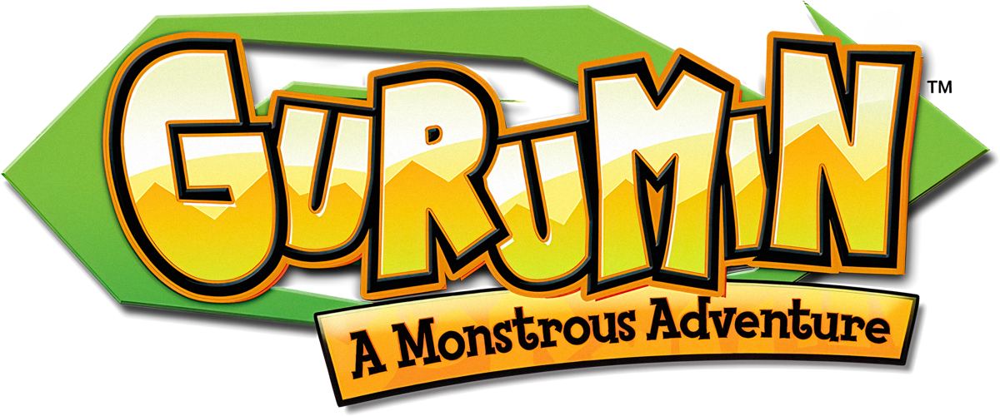

# Gurumin decompilation and modding

A matching decompilation of **Gurumin** (Japanese PC release, 2006) together with tools and documentation for
modding it. The target is the game code in `bin\APP.dll`. The goals, in order:

1. **Moddability:** readable source, named functions and documented file formats, so changes are easy to make.
2. **Modern hardware:** lift the 2006-era limits (frame rate, resolution, text rendering, input) on today's PCs.
3. **A byte-matching rebuild:** every function compiles back to the original bytes with the original compiler.

No game files are included. Point the tools at your own copy of the game.

## Progress

The meter is regenerated with every progress report and refreshed by CI on each push to `master`; the same data is
published as the `jp_report` artifact for ByteMatch. Matched functions are the smaller ones
so far: a few very large functions (the model loader at 0x1017cc90 alone is 29,886 bytes) hold most of the code, so
the byte share lags the function share. `python decomp/tools/build_all.py` prints the current figures and
`decomp/tools/todo.py` lists what is left.

## What you can do today

### Modding tools (`tools/`, Python 3; Pillow for images)
| Tool | Does |
|---|---|
| `itm_tool.py decode/encode` | `.itm` scripts, tables and BMPs (map.itm, 3ddata\*.itm) ↔ plain text. 2,511 files round-trip. |
| `iti_tool.py decode/encode/info` | `.iti` textures ↔ PNG (all types; 666/667 via your packs.dll and tools/native/iti_unpack.c; writes raw type 0/1). |
| `it3_tool.py info/obj` | `.it3` model node list; OBJ export with normals and UVs. All 945 JP models decode. |
| `gpack.py` | Python port of packs.dll `ExecUnpack` (used by .it3 meshes). |
| `mmv_tool.py info/frames/gif/encode` | `.mmv` movies ↔ PNG frames or GIF. All 67 JP movies rebuild byte-identical. 2x/4x frames make HD movies. |
| `de2_tool.py info/decode/encode` | `.de2` music ↔ WAV (MS ADPCM; encoding untested in game). |
| `ddfont_tool.py export/import` | in-game font ↔ PNG atlas (byte-identical round trip). |
| `save_tool.py decode/encode/info/thumb` | `SaveData\gdataNN.sav` ↔ raw state; thumbnail extract. |
| `script_api.py`, `gen_script_api_md.py` | script built-in list → `docs/SCRIPT_API.md`. |
| `config_keys.py`, `save_layout.py` | gurumin.def key map, save body map (from the decompiler output). |
| `gurumin_tools_gui.py` | one window for all of the above (Tkinter, no extra install): see below. |

### Modding GUI
`python tools/gurumin_tools_gui.py` opens one window over all the tools: pick the game folder once, then export
files to editable PNG/text/WAV/OBJ/GIF, import them back, or batch-convert whole folders. The **Mod** tab exports
game files into a mod folder (`edit\`), shows which ones you changed, and repackages them into `out\` with the
game's folder layout. The game folder is only read. Walkthrough: [`docs/GUI.md`](docs/GUI.md).

### Mod DLL (`mod/`): replacement files and HD movies
A `d3d9.dll` for the Japanese PC version, loaded next to `game.exe`; it changes nothing on disk. It loads any
game file from a `mod\` folder in the game folder in place of the original, by name, and turns PNG textures of any
size up to 2048x2048 into the game's format on the fly ([`docs/MODDING_FILES.md`](docs/MODDING_FILES.md)). It plays `.mmv`
movies made at 2x or 4x their original size at the original size on screen with the extra detail
([`docs/MOVIES_HD.md`](docs/MOVIES_HD.md)). `mmv_tool.py encode` and the GUI make an HD movie from larger frames
on their own, and the GUI's repackage adds the DLL to `out\`. Install by hand with
`mod\install.bat "C:\path\to\Gurumin"`. Widescreen and any resolution are in the same DLL but parked and off
([`docs/DISPLAY_MOD.md`](docs/DISPLAY_MOD.md)).

### Documentation (`docs/`)
`MODDING_MAP.md` (start here: costumes, anti-cheat guards, render states, sound, menu images), `ITM_FORMAT.md`,
`SCRIPT_API.md`, `MAP_TABLES.md`, `SAVE_FORMAT.md`, `PACKS_DLL.md`, `config_keys.tsv`, `save_layout.tsv`.
Function names: `symbols.tsv` (apply to Ghidra with `re/apply_symbols.bat`).

## Decompilation (`decomp/`)
- Compiler: Visual Studio .NET 2002, cl 13.00.9466, the exact build in APP.dll's Rich header (`decomp/env.bat`; set
  `GURUMIN_VC` to another `Vc7` folder to override). Flags `/O2 /Ob1 /Op /Gy /GS /GX`; experiment flags go in
  `GURUMIN_CFLAGS`.
- Build and compare: `decomp\build.bat <file.cpp>` compiles one file and byte-compares every function with APP.dll
  (relocations masked); `decomp\build_all.bat` or `python decomp/tools/build_all.py --report progress/jp/report.json`
  does everything and writes the report and the meter.
- Helpers: `tools/variants.py` builds `#if V == k` variants of a file, `tools/pick.py` keeps one, `tools/sbs.py` shows
  our code and the original side by side, `tools/asm.py` / `tools/fn.py` show the original's disassembly / Ghidra output.
- Source style: readable names and plenty of comments (what each function does, its fields and constants).
- Functions that still differ are listed in `decomp/open.tsv` with the reason; the work queue is `decomp/QUEUE.md`;
  findings and compiler habits are in `NOTES.md`.
- Ghidra: `re\run_ghidra_export.bat` (APP.dll), `re\run_ghidra_packs.bat` (packs.dll); exports land in `re\export\`
  (local only).

## Contributing
Contributions from people and from AI agents are welcome. Start with [`AGENTS.md`](AGENTS.md): the rules every
change follows (typed struct members instead of fixed offsets, each type declared once in a shared header, no
fakematches, commented source) and the build commands. `CLAUDE.md` points Claude Code there; `NOTES.md` holds the
findings so far. You need your own copy of the game and VS .NET 2002 (cl 13.00.9466).

## Roadmap
Decompilation and naming come first. Planned once they are far enough along (details in
[`docs/ROADMAP.md`](docs/ROADMAP.md)):
- Higher frame rates, wide and ultrawide resolutions and other rendering upgrades (building on or bundling the
  MIT-licensed Gurumin Enhanced Rendering mod), and support for the PSP-exclusive costumes when you supply the files.
- **Costume transmog:** wear any unlocked costume's look while keeping another costume's abilities.
- A Unicode subtitle and text font from any TrueType/OpenType font, and in-game selection of voice, text and subtitle
  languages.
- An all-in-one GUI tool (exe) for the file tools, with a model viewer and OBJ import/replacement.
- A texture glossary, and a `textures` folder for loose texture overrides.
